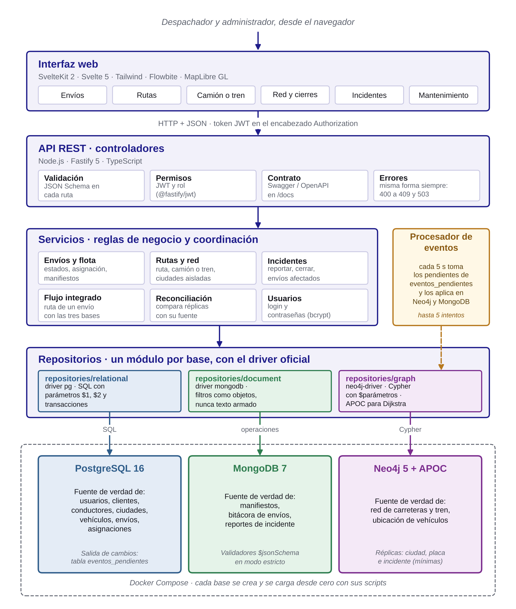
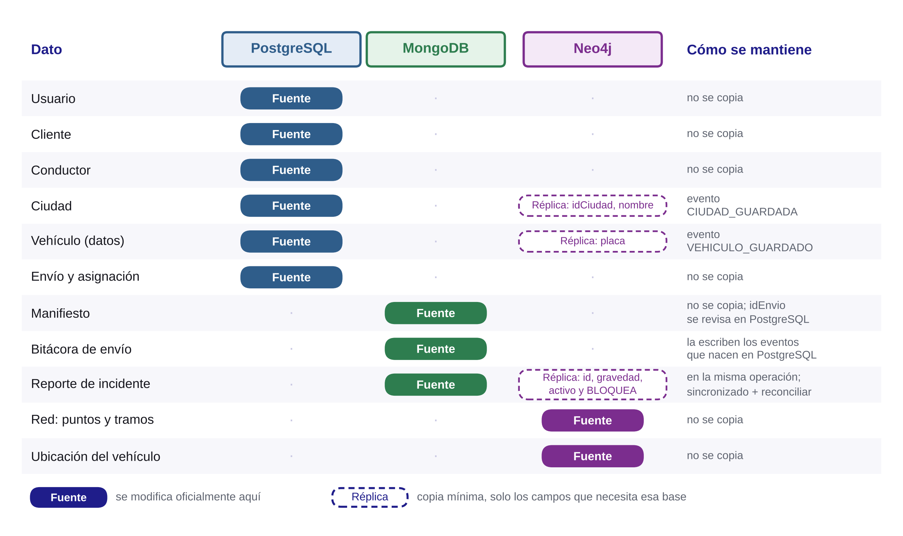
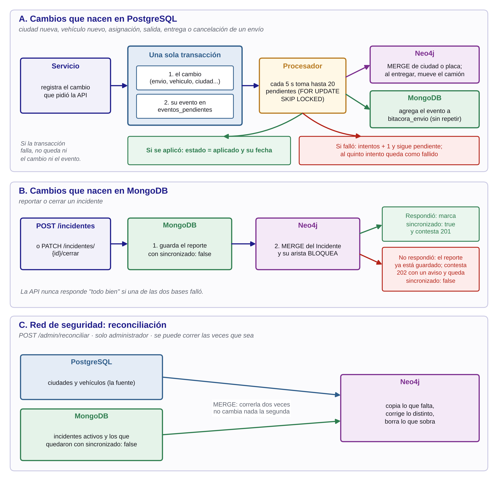
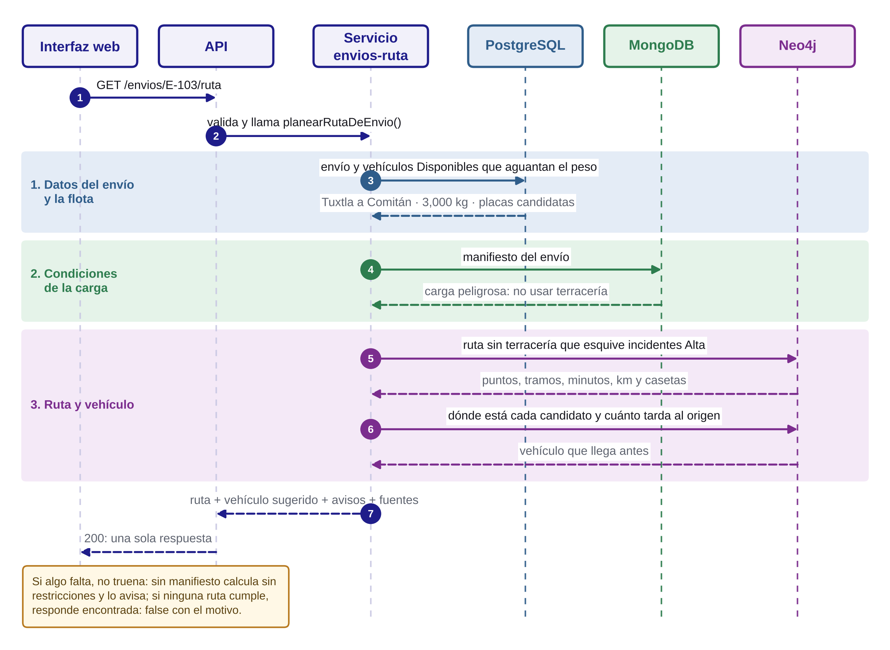

# Entregable 3. Arquitectura

Este documento explica cómo está armada la aplicación, qué hace cada capa, con qué tecnología se construyó cada parte y cómo se coordinan PostgreSQL, MongoDB y Neo4j cuando una operación necesita más de una base. La comparación de tecnologías y la justificación del stack están aparte, en [decisiones-tecnologicas.md](decisiones-tecnologicas.md).

Los diagramas están en `docs/img/arquitectura/`. Sus fuentes son scripts de matplotlib en `docs/img/arquitectura/fuentes/`; para regenerarlos basta con correr `python3 d_arquitectura.py` (y los demás) dentro de esa carpeta.

## 1. Diagrama de arquitectura

La aplicación sigue la arquitectura de integración de la guía (sección 8): la interfaz habla solo con la API, la API pasa cada solicitud a un servicio, y el servicio usa repositorios separados para cada base. Todo corre en un solo backend modular; no hay microservicios ni transacciones distribuidas, porque el alcance no lo pide.

Cómo se lee el diagrama, de arriba hacia abajo:

1. La interfaz (SvelteKit) es un sitio estático que corre en el navegador. No conoce las bases ni sus credenciales; solo sabe la dirección de la API (`VITE_API_URL`) y guarda el token de sesión.
2. La API (Fastify) recibe la solicitud, valida el cuerpo y los parámetros con JSON Schema, revisa el token y el rol, y al final convierte cualquier error al mismo formato `{error, mensaje, statusCode}`.
3. Los servicios tienen las reglas de negocio. Son los únicos que deciden qué base se consulta, en qué orden y qué pasa si una falla.
4. Los repositorios tienen las consultas: SQL en `repositories/relational/`, operaciones de MongoDB en `repositories/document/` y Cypher en `repositories/graph/`. Un servicio nunca escribe una consulta directamente.
5. Las tres bases corren en contenedores de Docker Compose y se crean con sus datos de prueba la primera vez que se levantan.

Al lado de los servicios está el procesador de eventos, un proceso dentro del mismo backend que cada 5 segundos aplica en MongoDB y Neo4j los cambios que nacieron en PostgreSQL (sección 6).

## 2. Responsabilidades de cada capa

### 2.1 Frontend

Está en `frontend/` y se compila como sitio estático (`adapter-static`, sin SSR). Sus pantallas son:

- Inicio con el mapa de la red: municipios, tramos, estaciones, incidentes activos y la ubicación de cada vehículo.
- Entrar: inicio de sesión del despachador o del administrador.
- Envíos: lista, alta, manifiesto, asignación de vehículo, salida, entrega y cancelación, y la ruta planeada de cada envío.
- Red: rutas entre dos ciudades por tiempo, distancia o costo, y la exploración por número de saltos.
- Incidentes: reporte, cierre y la lista de envíos afectados con su desvío.
- Camión o tren: compara ir todo por carretera contra pasar la carga al tren de la costa.
- Mantenimiento: altas y cambios de ciudades, tramos, vehículos, clientes y conductores, y el botón de reconciliación.

Qué hace: muestra datos, arma las solicitudes y presenta los avisos que regresa la API (por ejemplo, "el envío no tiene manifiesto"). Qué no hace: no calcula rutas, no valida reglas de negocio por su cuenta ni decide a qué base va un dato. El cliente de la API está en `frontend/src/lib/api.ts` y la sesión en `frontend/src/lib/sesion.svelte.ts`.

### 2.2 API

Está en `backend/src/server.ts`, `backend/src/controllers/`, `backend/src/schemas/` y `backend/src/plugins/`.

- Contrato: cada ruta declara su JSON Schema; Fastify rechaza con 400 lo que no cumple antes de llegar al servicio. Swagger publica el contrato en `/docs`.
- Permisos: el plugin `auth.ts` verifica el JWT y expone `requiereRol("despachador", "administrador")`. Las escrituras piden sesión; las consultas son públicas.
- Errores: un manejador global traduce los errores propios (404, 409, 400) y los de las bases. Código 121 de MongoDB (no cumple el validador) se vuelve 400, llave repetida en MongoDB (11000) o en PostgreSQL (23505) se vuelve 409, y una base que no responde se vuelve 503.
- Los controladores no tienen lógica: leen parámetros, llaman a un servicio y regresan el resultado con su código.

### 2.3 Servicios

Están en `backend/src/services/`. Aquí viven las reglas del negocio y la coordinación entre bases. Los más importantes para la integración son:

- `envios.service.ts`: alta de envíos, asignación, salida, entrega y cancelación, cada una dentro de una transacción de PostgreSQL que también deja el evento para las otras bases. También valida y guarda el manifiesto en MongoDB después de revisar en PostgreSQL que el envío existe.
- `envios-ruta.service.ts`: el flujo integrado `GET /envios/:id/ruta` (sección 7).
- `envios-afectados.service.ts`: qué envíos en camino pasan por el punto de un incidente y cuánto les cuesta el desvío. Lee de las tres bases.
- `incidentes.service.ts`: guarda el reporte en MongoDB y su réplica en Neo4j, y responde 201 o 202 según haya salido la segunda escritura.
- `procesadorEventos.service.ts`: aplica los eventos pendientes de PostgreSQL.
- `reconciliacion.service.ts`: compara cada réplica del grafo contra su fuente de verdad y corrige diferencias.
- `rutas.service.ts`, `rutas.exploracion.ts` y `red.service.ts`: rutas, exploración y mantenimiento de la red en Neo4j.

### 2.4 Repositorios

Están en `backend/src/repositories/`, uno por tema y por base. Cada función hace una consulta y regresa objetos del dominio, no filas ni registros del driver. Las conexiones se abren una vez en `backend/src/db/` (`postgres.ts`, `mongo.ts`, `neo4j.ts`); `postgres.ts` además ofrece `enTransaccion`, que da a los repositorios el mismo cliente para que todo quede en un solo `BEGIN ... COMMIT`.

| Carpeta | Base | Repositorios |
|---|---|---|
| `relational/` | PostgreSQL | usuarios, clientes, conductores, ciudades, vehículos, envíos, asignaciones, eventos, ubicación, envíos afectados, reconciliación, salud |
| `document/` | MongoDB | manifiestos, bitácora, incidentes, restricciones, salud |
| `graph/` | Neo4j | red, rutas, mapa, incidentes, ubicación, reconciliación, salud |

## 3. Tecnologías por componente

| Componente | Tecnología | Versión | Para qué se usa |
|---|---|---|---|
| Interfaz | SvelteKit con Svelte 5 | 2.x / 5.x | Pantallas y navegación; compilado como sitio estático |
| Estilos y componentes | Tailwind CSS y Flowbite Svelte | 4.x / 1.x | Formularios, tablas, avisos e iconos (Lucide) |
| Mapa | MapLibre GL con estilo de OpenFreeMap | 5.x | Dibujar la red, las rutas, los incidentes y los vehículos |
| API | Fastify con TypeScript | 5.x | Rutas, validación con JSON Schema, manejo de errores |
| Autenticación | @fastify/jwt y bcryptjs | 10.x / 3.x | Token de sesión y contraseñas con hash |
| Documentación de la API | @fastify/swagger y swagger-ui | 9.x / 6.x | Contrato navegable en `/docs` |
| Driver relacional | pg (node-postgres) | 8.x | Consultas parametrizadas y transacciones |
| Driver documental | mongodb | 7.x | Colecciones con validador `$jsonSchema` |
| Driver de grafos | neo4j-driver | 6.x | Cypher por Bolt |
| Base relacional | PostgreSQL | 16 | Fuente de verdad de usuarios, catálogos, envíos y asignaciones |
| Base documental | MongoDB | 7 | Manifiestos, bitácora de cada envío y reportes de incidente |
| Base de grafos | Neo4j con APOC | 5 | Red de transporte, rutas (Dijkstra de APOC) y ubicación de vehículos |
| Pruebas | Vitest | 5.x | Pruebas unitarias, de integración y de consistencia |
| Infraestructura | Docker Compose | | Levantar las tres bases con sus esquemas y datos de prueba |

## 4. Matriz de responsabilidades

Es la matriz de la sección 5.1 de la guía, adaptada a Hopwright.

| Aspecto | PostgreSQL (relacional) | MongoDB (documental) | Neo4j (grafo) |
|---|---|---|---|
| Entidades o datos | Usuarios, clientes, conductores, ciudades, vehículos, envíos, asignaciones y la cola `eventos_pendientes` | Manifiestos de carga, bitácora de cada envío y reportes de incidente | Municipios, intersecciones y estaciones, tramos de carretera y de vía férrea, incidentes y dónde está cada vehículo |
| Estructura | Tablas con llaves primarias y foráneas, `CHECK`, `UNIQUE` e índices | Colecciones `manifiestos`, `bitacora_envio`, `reportes_incidente` y `contadores`, con validador `$jsonSchema` | Etiquetas `Ciudad`, `Interseccion`, `Estacion`, `Vehiculo` e `Incidente`; relaciones `CARRETERA`, `VIA_FERREA`, `UBICADA_EN`, `BLOQUEA` y `SE_ENCUENTRA_EN` |
| Operaciones | Altas y cambios de catálogos; ciclo de vida del envío (Pendiente, Asignado, En camino, Entregado, Cancelado) en transacciones | Crear y leer manifiestos con campos distintos por tipo de carga; agregar eventos a la bitácora; reportar y cerrar incidentes | Ruta más corta por tiempo, distancia o costo; exploración por saltos; desvíos que esquivan incidentes; vehículo más cercano |
| Reglas | Un envío solo puede tener una asignación activa; el vehículo debe estar disponible y aguantar el peso; los estados cambian en orden | Cada tipo de carga trae exactamente sus campos (`oneOf`): la peligrosa lleva clase UN y evita terracería, la refrigerada lleva temperaturas y tiempo máximo; la gravedad es Baja, Media o Alta | Todo tramo tiene su regreso; un incidente activo de gravedad Alta saca su punto de las rutas; `CARRETERA` solo une ciudades e intersecciones y `VIA_FERREA` solo estaciones; un tren solo puede estar en una estación |
| Pruebas | Restricciones, transacciones que se deshacen completas y consultas de envíos | Documentos válidos e inválidos contra el validador y consultas de manifiesto y bitácora | Cantidad de puntos y tramos, rutas conocidas, rutas con incidentes y exploración |

## 5. Fuente de verdad

Cada dato se modifica oficialmente en una sola base. Si otra base necesita una parte de ese dato, guarda una copia mínima (réplica) que nunca se edita directamente.

### 5.1 Qué se replica y para qué

| Dato | Fuente | Se copia a | Campos copiados | Para qué |
|---|---|---|---|---|
| Ciudad | PostgreSQL | Neo4j | `idCiudad`, `nombre` | El grafo necesita la ciudad como nodo para conectarla con tramos y calcular rutas |
| Vehículo | PostgreSQL | Neo4j | `placa` | El nodo `Vehiculo` se enlaza con `SE_ENCUENTRA_EN` al punto donde está, para buscar el más cercano a un origen |
| Reporte de incidente | MongoDB | Neo4j | `idIncidente`, `gravedad`, `activo` y la relación `BLOQUEA` al punto | Las rutas deben esquivar los puntos bloqueados sin ir a MongoDB en cada paso del recorrido |
| Eventos del envío | PostgreSQL | MongoDB (bitácora) | Tipo de evento, fecha y detalle (placa, ciudad) | Tener el historial completo del envío en un solo documento |

Lo que no está en la tabla no se copia. Los manifiestos guardan `idEnvio`, pero es una referencia, no una copia: el servicio revisa en PostgreSQL que el envío exista antes de crear el manifiesto. Lo mismo pasa con `idPunto` en el reporte de incidente, que se revisa contra Neo4j.

## 6. Estrategia de sincronización

Hay dos mecanismos, según dónde nace el cambio, y un tercero de respaldo.

### 6.1 Cambios que nacen en PostgreSQL: cola de eventos (outbox)

Cuando un servicio guarda una ciudad, un vehículo o cambia el estado de un envío, en la misma transacción inserta una fila en `eventos_pendientes` con el tipo y los datos del cambio. Si la transacción falla, el evento tampoco existe; si se confirma, el evento queda guardado aunque MongoDB o Neo4j estén caídos en ese momento.

El procesador de eventos corre cada 5 segundos:

1. Toma hasta 20 eventos con `estado = 'pendiente'` e `intentos < 5`, usando `FOR UPDATE SKIP LOCKED` para que dos procesos no tomen el mismo.
2. Los aplica en orden de llegada:
   - `CIUDAD_GUARDADA`: `MERGE (c:Ciudad {idCiudad}) SET c.nombre` en Neo4j.
   - `VEHICULO_GUARDADO`: `MERGE (v:Vehiculo {placa})` en Neo4j.
   - `ASIGNACION_CREADA`, `ENVIO_SALIO`, `ENVIO_CANCELADO`: agregan el evento a la bitácora del envío en MongoDB.
   - `ENVIO_ENTREGADO`: agrega el evento a la bitácora y mueve el vehículo a la ciudad de destino en Neo4j.
3. Si sale bien, marca el evento como `aplicado`. Si falla, suma un intento y guarda el error; al quinto intento queda como `fallido` para revisarlo a mano.

Aplicar un evento dos veces no cambia nada: en Neo4j todo es `MERGE`, y la bitácora no agrega un evento que ya tiene.

### 6.2 Cambios que nacen en MongoDB: incidentes con bandera `sincronizado`

Reportar o cerrar un incidente escribe en las dos bases dentro de la misma solicitud:

1. Se guarda el reporte en MongoDB con `sincronizado: false`.
2. Se hace `MERGE` del nodo `Incidente` y su relación `BLOQUEA` en Neo4j.
3. Si Neo4j respondió, se marca `sincronizado: true` y la API regresa 201 (o 200 al cerrar).
4. Si Neo4j no respondió, el reporte ya quedó guardado en su fuente de verdad. La API regresa 202 con un aviso, y el reporte se queda con `sincronizado: false` hasta la reconciliación.

### 6.3 Respaldo: reconciliación

`POST /admin/reconciliar` (solo administrador) compara cada réplica del grafo contra su fuente:

- Incidentes: copia al grafo los que falten o no coincidan en gravedad, estado o punto, y borra del grafo los que ya no existen en MongoDB.
- Ciudades: crea en el grafo las que faltan y corrige el nombre. Las que solo están en el grafo no se borran porque tienen tramos; solo se reportan.
- Vehículos: crea los que faltan y borra los que sobran.

Usa `MERGE` en todas las escrituras, así que correrla dos veces seguidas no cambia nada la segunda vez. Regresa un resumen con lo que revisó y lo que corrigió.

## 7. Flujo integrado: planear la ruta de un envío

Es el flujo equivalente al de la sección 8.1 de la guía. `GET /envios/:id/ruta` junta las tres bases en una sola respuesta. El ejemplo es el envío E-103: 3,000 kg de carga peligrosa de Tuxtla Gutiérrez a Comitán.

1. La pantalla de Envíos pide `GET /envios/E-103/ruta?criterio=tiempo`.
2. El servicio busca el envío en PostgreSQL: origen, destino, peso y estado. Si no existe, responde 404 y no toca las otras bases.
3. En PostgreSQL también obtiene los vehículos disponibles que aguantan 3,000 kg.
4. En MongoDB lee el manifiesto. Como la carga es peligrosa, la ruta debe evitar terracería; si fuera refrigerada, tendría un tiempo máximo.
5. En Neo4j calcula la ruta con el criterio pedido, sin tramos de terracería, sin tramos cerrados y sin pasar por puntos con un incidente activo de gravedad Alta.
6. En Neo4j busca cuál de los vehículos candidatos está más cerca del origen.
7. El servicio arma una respuesta con la ruta, los minutos, los kilómetros, las casetas, el vehículo sugerido, los avisos y un campo `fuentes` que dice qué aportó cada base.

Datos faltantes: si el envío no tiene manifiesto, la ruta se calcula sin restricciones y la respuesta lo avisa. Si no hay vehículos con capacidad, se calcula la ruta igual y se avisa. Si no hay ruta posible (por ejemplo, todos los caminos pasan por un punto bloqueado), `encontrada` es `false` y el aviso lo explica. En la prueba de rendimiento este flujo tardó 138.6 ms en la mediana y 176.5 ms en el percentil 95.

Otras operaciones que también cruzan bases:

- `GET /incidentes/:id/envios-afectados`: el incidente en MongoDB, los envíos en camino y su vehículo en PostgreSQL, y la ruta con y sin desvío en Neo4j.
- `POST /envios/:id/manifiesto`: revisa el envío en PostgreSQL y guarda el documento en MongoDB.
- `POST /envios/:id/entrega`: cambia estados en PostgreSQL y, por evento, escribe la bitácora en MongoDB y mueve el vehículo en Neo4j.

## 8. Consistencia ante fallas parciales

Una operación que toca varias bases puede quedar a medias. Esto es lo que pasa en cada caso y cómo se corrige.

| Situación | Qué pasa | Cómo se recupera |
|---|---|---|
| Falla PostgreSQL a mitad de una transacción (asignar, entregar, guardar ciudad) | `ROLLBACK`: no queda ni el cambio ni el evento | Nada que corregir; la API responde el error y el usuario lo intenta de nuevo |
| MongoDB o Neo4j caídos cuando el procesador aplica un evento | El evento sigue `pendiente` con un intento más | Reintento automático cada 5 s, hasta 5 veces |
| Un evento falla 5 veces | Queda `fallido` con su último error | Se revisa en `eventos_pendientes` y se corre la reconciliación |
| Neo4j caído al reportar un incidente | El reporte queda en MongoDB con `sincronizado: false`; respuesta 202 | `POST /admin/reconciliar` lo copia al grafo |
| El manifiesto no cumple el validador de MongoDB | MongoDB lo rechaza (código 121) | La API responde 400 con el detalle; el envío en PostgreSQL no se toca |
| Una base no responde en una consulta | El driver agota el tiempo de espera | La API responde 503 con un mensaje claro en vez de un 500 |
| Una réplica del grafo se desvió por cualquier otra razón | Diferencia entre Neo4j y su fuente | La reconciliación la detecta y la corrige |

No se usan transacciones distribuidas. La guía lo permite para un proyecto de este tamaño, siempre que se reconozca el riesgo. Lo que se buscó es que el dato oficial nunca se pierda (siempre se escribe primero en su fuente), que las réplicas se puedan reconstruir desde la fuente en cualquier momento y que cada escritura en una réplica sea idempotente. Las pruebas de consistencia (`tests/consistencia/`) apagan Neo4j a propósito y revisan los dos casos principales: un vehículo registrado en ese momento se guarda en PostgreSQL y llega al grafo cuando Neo4j regresa, y un incidente reportado se queda con `sincronizado: false` hasta que la reconciliación lo copia.
