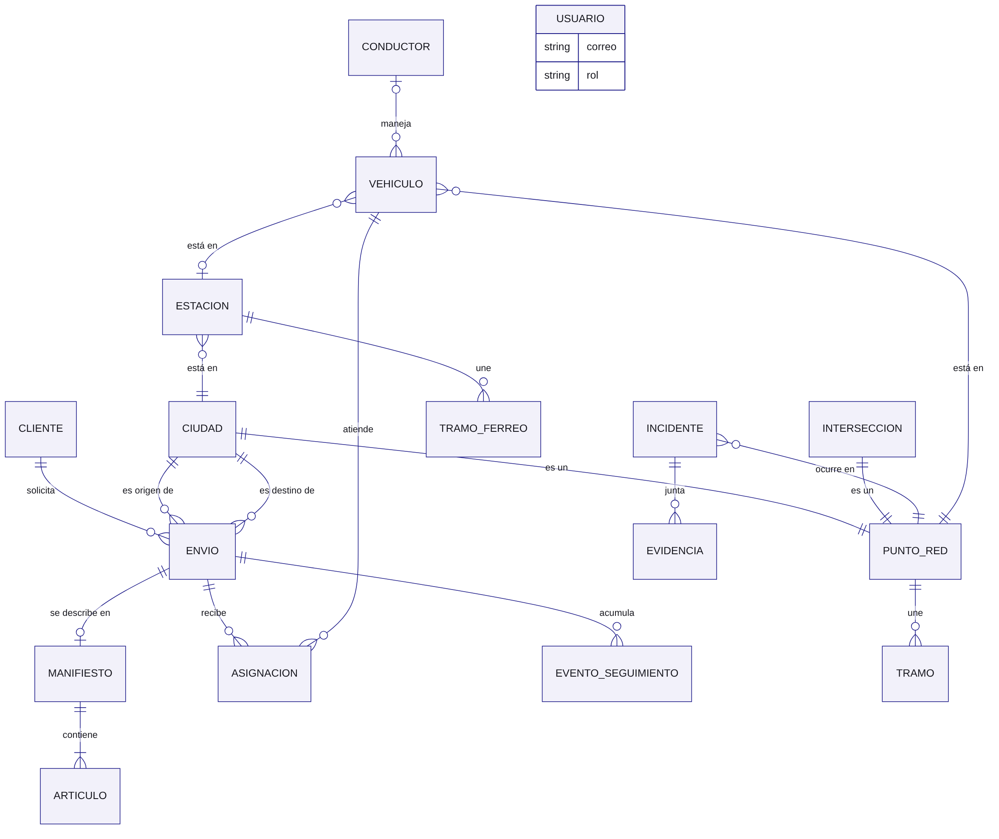
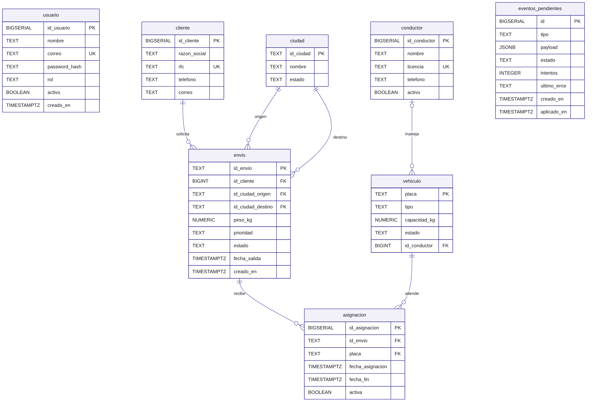
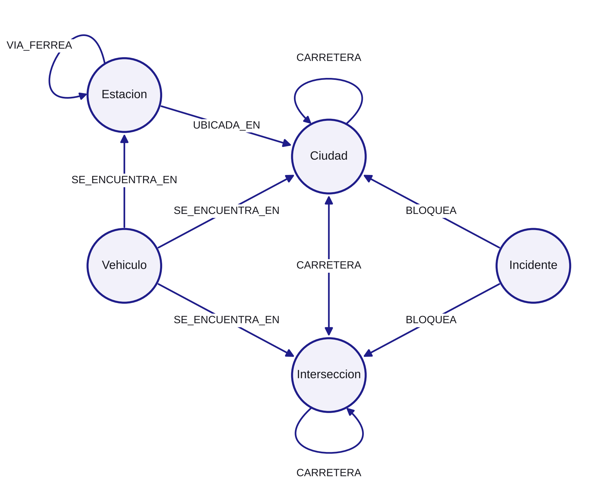

# Entregable 2. Modelado de datos

Este documento reúne el modelado completo de Hopwright: primero el modelo conceptual del dominio, sin pensar todavía en bases de datos; después cómo se repartió ese modelo entre PostgreSQL, MongoDB y Neo4j; luego el modelo lógico de cada base, el diccionario de datos y las reglas, con el lugar donde se revisa cada una.

Los detalles de cada base están en `docs/modelos/`. Los diagramas están en `docs/img/modelado/` y sus fuentes en `docs/img/modelado/fuentes/` (Mermaid para el conceptual y el relacional, un script de matplotlib para el de grafos). Aquí se juntan para que se vea que los cuatro modelos describen el mismo dominio y que ningún dato tiene dos dueños.

## 1. El dominio en pocas palabras

Una empresa de paquetería de Chiapas recibe envíos de sus clientes. Cada envío va de una ciudad a otra, pesa algo y lleva una carga descrita en un manifiesto. El despachador le asigna un vehículo (camión, tráiler o el tren de la costa) y sigue el envío hasta que se entrega. Mientras tanto, en la red de carreteras pasan cosas: bloqueos, accidentes, obras y derrumbes. La aplicación necesita saber qué envíos afecta un incidente, por dónde se puede rodear y si conviene pasar la carga al tren.

Usuarios: el despachador (registra envíos, asigna vehículos, reporta incidentes) y el administrador (además da de alta vehículos, ciudades y tramos, y corre la reconciliación). Las consultas no piden sesión.

## 2. Modelo conceptual común

Las entidades del dominio y cómo se relacionan, antes de decidir dónde vive cada una.



| Entidad | Qué representa | Identificador del dominio |
|---|---|---|
| Usuario | Persona que opera la aplicación, con rol de despachador o administrador | correo |
| Cliente | Empresa que manda la carga | RFC |
| Conductor | Persona que maneja un vehículo | licencia |
| Ciudad | Municipio de Chiapas | clave INEGI de 5 dígitos (`07101`) |
| Vehículo | Camión, tráiler o tren | placa (`CHP-1001`, `TREN-01`) |
| Envío | Carga que va de una ciudad a otra | `E-` y número (`E-102`) |
| Asignación | Qué vehículo lleva qué envío y durante qué periodo | número consecutivo |
| Manifiesto | Qué se transporta y con qué cuidados | el envío al que pertenece |
| Artículo | Renglón del manifiesto: descripción, cantidad y peso | posición dentro del manifiesto |
| Evento de seguimiento | Algo que le pasó al envío: se asignó, salió, se entregó, se canceló | tipo y fecha dentro del envío |
| Intersección | Cruce, glorieta o caseta de la carretera que no es ciudad | `INT-` y siglas (`INT-CHC`) |
| Estación | Estación del tren de carga de la costa | `EST-` y siglas (`EST-ARR`) |
| Tramo de carretera | Camino entre dos puntos, en un sentido, con distancia, tiempo, caseta y tipo de vía | los dos puntos y el tipo de vía |
| Tramo ferroviario | Vía entre dos estaciones, con distancia, tiempo y costo por tonelada | las dos estaciones |
| Incidente | Bloqueo, accidente, obra o derrumbe en un punto de la red | `INC-` y número (`INC-0001`) |
| Evidencia | Foto o testimonio que respalda un incidente | posición dentro del incidente |

Ciudad e intersección son los dos tipos de punto de carretera: un tramo puede unir dos ciudades, dos intersecciones o una de cada una. Un incidente ocurre en uno de esos puntos. Cada vehículo está en un punto de carretera o, si es el tren, en una estación; esa ubicación cambia con cada entrega.

El usuario no se relaciona con las demás entidades: solo sirve para iniciar sesión y decidir qué operaciones puede hacer cada rol.

## 3. Cómo se repartió el modelo entre las tres bases

Cada entidad tiene una sola base dueña, que es su fuente de verdad. Si otra base necesita una parte, guarda una réplica mínima y se documenta cómo se mantiene al día.

| Entidad | Base dueña | Réplica | Por qué ahí |
|---|---|---|---|
| Usuario, cliente, conductor | PostgreSQL | ninguna | Datos fijos con llaves únicas; necesitan integridad referencial |
| Ciudad | PostgreSQL | Neo4j: `idCiudad` y `nombre` | Es catálogo oficial (INEGI); el grafo la necesita como punto de la red |
| Vehículo | PostgreSQL | Neo4j: solo `placa` | Capacidad y estado se validan en transacciones junto con la asignación |
| Envío, asignación | PostgreSQL | ninguna | Cambios de estado con transacción y bloqueo de filas para no asignar dos veces |
| Manifiesto y artículos | MongoDB | ninguna | Cada tipo de carga trae campos distintos; los artículos viven dentro del manifiesto |
| Eventos de seguimiento | MongoDB (`bitacora_envio`) | ninguna | Lista que solo crece, se lee completa y en orden |
| Incidente y evidencias | MongoDB (`reportes_incidente`) | Neo4j: `idIncidente`, `gravedad`, `activo` y `BLOQUEA` | Detalle distinto por tipo; las evidencias se agregan mientras sigue abierto |
| Intersección, estación, tramos | Neo4j | ninguna | Las preguntas son de caminos: ruta más corta, puntos que se quedan sin salida |
| Ubicación del vehículo | Neo4j | ninguna | Es una conexión entre el vehículo y un punto de la red |

Prueba de que cada base hace falta: sin PostgreSQL no hay forma segura de asignar un vehículo a un envío sin que dos despachadores lo asignen a la vez. Sin MongoDB habría que partir el manifiesto y el incidente en una tabla por tipo o en columnas vacías. Sin Neo4j la ruta más corta y las ciudades aisladas serían consultas recursivas en SQL.

Los identificadores compartidos son los mismos en todas las bases: la clave INEGI de la ciudad (`id_ciudad` en PostgreSQL, `idCiudad` en Neo4j), la placa, el `E-n` del envío y el `INC-n` del incidente. Así se pueden cruzar sin tablas de equivalencia.

## 4. Modelo lógico relacional (PostgreSQL)

Script: `database/relational/schema/01_tablas.sql`. Datos de ejemplo: `database/relational/data/01_datos.sql`.



El modelo está en tercera forma normal: cada tabla describe una sola cosa y los datos de una entidad no se repiten en otra. `asignacion` resuelve la relación muchos a muchos entre envío y vehículo y guarda la historia: un vehículo hace muchos viajes, pero solo puede tener una asignación activa a la vez.

`eventos_pendientes` no es del dominio. Es la bandeja de salida (patrón outbox) para copiar cambios a Neo4j y MongoDB: el cambio y su evento se guardan en la misma transacción, así que nunca queda uno sin el otro.

Restricciones:

- Llaves foráneas de `envio` a `cliente` y `ciudad` (dos veces), de `vehiculo` a `conductor`, y de `asignacion` a `envio` y `vehiculo`.
- `UNIQUE` en `usuario.correo`, `cliente.rfc` y `conductor.licencia`.
- `CHECK` de formato: `id_ciudad` de 5 dígitos y `id_envio` con la forma `E-<dígitos>`.
- `CHECK` de dominio en `rol`, `vehiculo.tipo`, `vehiculo.estado`, `prioridad`, `envio.estado`, `eventos_pendientes.tipo` y `eventos_pendientes.estado`.
- `CHECK` de valores: `peso_kg > 0`, `capacidad_kg > 0`, `intentos >= 0` y origen distinto de destino.

Índices:

- `asignacion_vehiculo_activa_idx` y `asignacion_envio_activa_idx`: únicos parciales `WHERE activa`. Garantizan una asignación activa por vehículo y una por envío.
- `envio_id_cliente_idx`, `envio_origen_idx`, `envio_destino_idx`, `envio_estado_idx`: para los joins y el filtro por estado (envíos en camino).
- `vehiculo_estado_idx`, `vehiculo_conductor_idx`: vehículos disponibles y su conductor.
- `asignacion_envio_idx`, `asignacion_placa_idx`: historia de un envío o de un vehículo.
- `eventos_pendientes_estado_idx` sobre `(estado, creado_en)`: el procesador toma los pendientes más viejos primero.

## 5. Modelo documental (MongoDB)

Scripts: validadores en `database/document/validators/`, datos en `database/document/data/` y consultas en `database/document/queries/`. Las colecciones se crean con `validationLevel: "strict"` y `validationAction: "error"`, así que MongoDB rechaza cualquier documento inválido aunque no venga de la API.

Decisión de diseño: en las tres colecciones lo que cuelga de la entidad (artículos, eventos, evidencias, detalle por tipo) va embebido en el mismo documento, porque siempre se lee junto con su dueño y nunca por separado. Lo que pertenece a otra base se referencia por su identificador (`idEnvio`, `idPunto`), nunca se copia.

### `manifiestos`

Un documento por envío.

```js
{
  idEnvio: "E-103",                  // referencia al envío de PostgreSQL, único
  tipoCarga: "peligrosa",            // general | refrigerada | peligrosa
  articulos: [
    { descripcion: "Solvente industrial", cantidad: 40, pesoKg: 75 }
  ],
  // solo refrigerada: tempMinC, tempMaxC, tiempoMaxMin
  // solo peligrosa:
  claseUN: 3,                        // 1 a 9
  numeroONU: "UN1263",
  hojaSeguridad: "https://...",
  telefonoEmergencia: "9615550000",
  restriccionesRuta: { evitarTerraceria: true, tiempoMaxMin: null },
  creadoEn: ISODate("...")
}
```

El validador usa un `oneOf` para que cada tipo de carga traiga exactamente sus campos: una carga general no puede traer temperaturas ni clase UN, una refrigerada exige las temperaturas y el tiempo máximo, una peligrosa exige clase UN, número ONU, hoja de seguridad y teléfono de emergencia. `restriccionesRuta` es lo que lee el flujo integrado para calcular la ruta. Índice: `idEnvio_unico`.

### `bitacora_envio`

Un documento por envío con la lista de lo que le ha pasado.

```js
{
  idEnvio: "E-105",
  eventos: [
    { tipo: "ASIGNACION_CREADA", fecha: ISODate("..."), detalle: { idEnvio: "E-105", placa: "CHP-1003" } },
    { tipo: "ENVIO_SALIO",       fecha: ISODate("..."), detalle: { idEnvio: "E-105" } },
    { tipo: "ENVIO_ENTREGADO",   fecha: ISODate("..."), detalle: { idEnvio: "E-105", placa: "CHP-1003", moverA: "07089" } }
  ]
}
```

Solo la escribe el procesador de eventos pendientes, con los eventos que nacen en PostgreSQL. No acepta dos eventos con el mismo tipo y la misma fecha, y los mantiene ordenados por fecha aunque uno llegue tarde por un reintento. Índice: `idEnvio_unico`.

### `reportes_incidente`

Un documento por incidente.

```js
{
  idIncidente: "INC-0001",
  tipo: "Obra",                      // Bloqueo | Accidente | Obra | Derrumbe
  idPunto: "07094",                  // ciudad (5 dígitos) o intersección (INT-...)
  tipoPunto: "Ciudad",               // Ciudad | Interseccion
  gravedad: "Media",                 // Baja | Media | Alta
  descripcion: "Repavimentación en la entrada de Teopisca",
  fechaInicio: ISODate("..."),
  fechaFin: ISODate("..."),          // solo cuando ya se cerró
  motivoCierre: "...",               // opcional, al cerrar
  detalle: { dependencia: "SICT", fechaFinEstimada: ISODate("..."), horario: "8 a 18 h" },
  evidencias: [
    { tipo: "Foto", url: "https://...", autor: "Despacho Tuxtla", fecha: ISODate("...") }
  ],
  activo: true,
  sincronizado: true,                // false mientras el cambio no llega a Neo4j
  reportadoPor: "Despacho Tuxtla",
  creadoEn: ISODate("..."),
  actualizadoEn: ISODate("...")      // opcional
}
```

El `detalle` cambia según el tipo:

- Bloqueo: `causa` (Manifestación, Retén, Vehículo varado u Otro) y `carrilesCerrados`; `pasoAlternado` opcional.
- Accidente: `vehiculosInvolucrados` y `hayLesionados`; `autoridadEnSitio` opcional.
- Obra: `dependencia` y `fechaFinEstimada`; `horario` opcional.
- Derrumbe: `volumenEstimadoM3` y `requiereMaquinaria`.

Índices: `idIncidente_unico`; `activos_por_gravedad` sobre `(activo, gravedad, fechaInicio desc)` para la lista de la pantalla; `por_punto` sobre `(idPunto, activo)`; y `pendientes_de_sincronizar`, parcial, que solo indexa los documentos con `sincronizado: false` y es lo primero que busca la reconciliación.

### `contadores`

`{ _id: "incidentes", valor: 2 }`. Guarda el último número de incidente usado. El backend lo incrementa con `findOneAndUpdate` y `$inc`, que es atómico, así que dos reportes al mismo tiempo nunca reciben el mismo `INC-n`.

## 6. Modelo de grafos (Neo4j)

Scripts: restricciones en `database/graph/schema/01_restricciones.cypher`, red en `database/graph/data/`, consultas en `database/graph/queries/` y pruebas de integridad en `database/graph/tests/01_integridad.cypher`.



La red cubre todo Chiapas: 124 cabeceras municipales, 9 intersecciones y 5 estaciones, unidas por 333 tramos de carretera (666 aristas, una por sentido) y 4 tramos de vía férrea. Distancias y tiempos salen de OSRM sobre OpenStreetMap; los tiempos se multiplican por 1.2 para un camión de carga.

Cada tramo de carretera son dos aristas, una por sentido, porque la ida y la vuelta pueden tardar distinto. Envío ya no es un nodo, como lo era en el primer modelo lógico de la actividad de grafos: vive solo en PostgreSQL y las consultas reciben origen y destino como parámetros. Así el mismo envío no queda en dos bases.

Cardinalidades:

- Cada estación está en exactamente una ciudad; una ciudad tiene cero o varias estaciones.
- Cada incidente bloquea exactamente un punto; un punto puede tener cero o varios incidentes.
- Cada vehículo está en exactamente un punto.
- Todo punto tiene al menos un tramo de salida y uno de llegada.

Restricciones: unicidad de `idCiudad`, `idInterseccion`, `idEstacion`, `Estacion.nombre`, `idIncidente` y `placa`. Índices en `Ciudad.nombre` e `Incidente.activo`. La imagen es Neo4j Community, que solo permite restricciones de unicidad; las propiedades obligatorias y los valores permitidos los valida el backend antes de escribir y los revisan las pruebas de integridad.

## 7. Diccionario de datos

Columna "Oblig." indica si el campo es obligatorio. Los valores entre llaves son los únicos permitidos.

### PostgreSQL

**usuario**

| Campo | Tipo | Oblig. | Regla o valores | Descripción |
|---|---|---|---|---|
| id_usuario | BIGSERIAL | Sí | PK | Número interno |
| nombre | TEXT | Sí | | Nombre de la persona |
| correo | TEXT | Sí | Único | Con este inicia sesión |
| password_hash | TEXT | Sí | bcrypt | La contraseña nunca se guarda en claro |
| rol | TEXT | Sí | {despachador, administrador} | Qué puede hacer en la API |
| activo | BOOLEAN | Sí | Por omisión true | Un usuario inactivo no entra |
| creado_en | TIMESTAMPTZ | Sí | Por omisión NOW() | Fecha de alta |

**cliente**

| Campo | Tipo | Oblig. | Regla o valores | Descripción |
|---|---|---|---|---|
| id_cliente | BIGSERIAL | Sí | PK | Número interno |
| razon_social | TEXT | Sí | | Nombre de la empresa |
| rfc | TEXT | Sí | Único | Registro fiscal |
| telefono | TEXT | No | | Contacto |
| correo | TEXT | No | | Contacto |

**conductor**

| Campo | Tipo | Oblig. | Regla o valores | Descripción |
|---|---|---|---|---|
| id_conductor | BIGSERIAL | Sí | PK | Número interno |
| nombre | TEXT | Sí | | Nombre completo |
| licencia | TEXT | Sí | Única | Número de licencia federal |
| telefono | TEXT | No | | Contacto |
| activo | BOOLEAN | Sí | Por omisión true | Si sigue trabajando |

**ciudad**

| Campo | Tipo | Oblig. | Regla o valores | Descripción |
|---|---|---|---|---|
| id_ciudad | TEXT | Sí | PK, 5 dígitos | Clave de municipio del INEGI; también es `idCiudad` en Neo4j |
| nombre | TEXT | Sí | | Nombre del municipio |
| estado | TEXT | Sí | | Entidad federativa (Chiapas) |

**vehiculo**

| Campo | Tipo | Oblig. | Regla o valores | Descripción |
|---|---|---|---|---|
| placa | TEXT | Sí | PK, mayúsculas sin espacios | También es la `placa` del nodo `Vehiculo` |
| tipo | TEXT | Sí | {Camión, Tráiler, Tren} | Define dónde puede estar (R11) |
| capacidad_kg | NUMERIC(10,2) | Sí | > 0 | Peso máximo que carga |
| estado | TEXT | Sí | {Disponible, En ruta, En taller} | Solo uno Disponible se asigna |
| id_conductor | BIGINT | No | FK a conductor | Quién lo maneja; el tren no tiene |

**envio**

| Campo | Tipo | Oblig. | Regla o valores | Descripción |
|---|---|---|---|---|
| id_envio | TEXT | Sí | PK, `E-<dígitos>` | Mismo formato que exige MongoDB |
| id_cliente | BIGINT | Sí | FK a cliente | Quién manda la carga |
| id_ciudad_origen | TEXT | Sí | FK a ciudad | De dónde sale |
| id_ciudad_destino | TEXT | Sí | FK a ciudad, distinta del origen | A dónde llega |
| peso_kg | NUMERIC(10,2) | Sí | > 0 | Peso total |
| prioridad | TEXT | Sí | {Normal, Urgente} | |
| estado | TEXT | Sí | {Pendiente, Asignado, En camino, Entregado, Cancelado} | Avanza solo en ese orden (RN9) |
| fecha_salida | TIMESTAMPTZ | No | | Se llena al salir |
| creado_en | TIMESTAMPTZ | Sí | Por omisión NOW() | Fecha de registro |

**asignacion**

| Campo | Tipo | Oblig. | Regla o valores | Descripción |
|---|---|---|---|---|
| id_asignacion | BIGSERIAL | Sí | PK | Número interno |
| id_envio | TEXT | Sí | FK a envio | Envío asignado |
| placa | TEXT | Sí | FK a vehiculo | Vehículo que lo lleva |
| fecha_asignacion | TIMESTAMPTZ | Sí | Por omisión NOW() | Inicio |
| fecha_fin | TIMESTAMPTZ | No | Nula mientras está activa | Se llena al entregar o cancelar |
| activa | BOOLEAN | Sí | Una activa por envío y una por vehículo | |

**eventos_pendientes**

| Campo | Tipo | Oblig. | Regla o valores | Descripción |
|---|---|---|---|---|
| id | BIGSERIAL | Sí | PK | Orden de llegada |
| tipo | TEXT | Sí | {CIUDAD_GUARDADA, VEHICULO_GUARDADO, ASIGNACION_CREADA, ENVIO_SALIO, ENVIO_ENTREGADO, ENVIO_CANCELADO} | Qué hay que copiar |
| payload | JSONB | Sí | | Datos del cambio (por ejemplo `idEnvio`, `placa`, `moverA`) |
| estado | TEXT | Sí | {pendiente, aplicado, fallido} | Por omisión pendiente |
| intentos | INTEGER | Sí | >= 0 | Cuántas veces se intentó aplicar |
| ultimo_error | TEXT | No | | Mensaje del último fallo |
| creado_en | TIMESTAMPTZ | Sí | Por omisión NOW() | |
| aplicado_en | TIMESTAMPTZ | No | | Cuándo llegó a la otra base |

### MongoDB

**manifiestos**

| Campo | Tipo | Oblig. | Regla o valores | Descripción |
|---|---|---|---|---|
| idEnvio | string | Sí | `^E-[0-9]+$`, único, debe existir en PostgreSQL | Envío al que pertenece |
| tipoCarga | string | Sí | {general, refrigerada, peligrosa} | Decide qué otros campos lleva |
| articulos | array | Sí | Al menos 1 | Lo que se transporta |
| articulos.descripcion | string | Sí | 1 a 200 caracteres | |
| articulos.cantidad | número | Sí | >= 1 | |
| articulos.pesoKg | número | Sí | >= 0.01 | |
| tempMinC, tempMaxC | número | Solo refrigerada | | Rango de temperatura |
| tiempoMaxMin | número | Solo refrigerada | >= 1 | Minutos máximos de viaje |
| claseUN | entero | Solo peligrosa | 1 a 9 | Clase de mercancía peligrosa |
| numeroONU | string | Solo peligrosa | 1 a 20 caracteres | Número ONU de la sustancia |
| hojaSeguridad | string | Solo peligrosa | 1 a 500 caracteres | Enlace a la hoja de seguridad |
| telefonoEmergencia | string | Solo peligrosa | 5 a 30 caracteres | |
| restriccionesRuta.evitarTerraceria | bool | Sí | true en carga peligrosa | La ruta no usa terracería |
| restriccionesRuta.tiempoMaxMin | número o null | Sí | >= 1 | Tiempo máximo que acepta la ruta |
| creadoEn | date | Sí | | |

**bitacora_envio**

| Campo | Tipo | Oblig. | Regla o valores | Descripción |
|---|---|---|---|---|
| idEnvio | string | Sí | `^E-[0-9]+$`, único | Envío al que pertenece |
| eventos | array | Sí | Ordenado por fecha, sin repetir tipo y fecha | Historia del envío |
| eventos.tipo | string | Sí | 1 a 80 caracteres | Mismo tipo que el evento de PostgreSQL |
| eventos.fecha | date | Sí | | Cuándo pasó |
| eventos.detalle | object | Sí | | Datos del evento |

**reportes_incidente**

| Campo | Tipo | Oblig. | Regla o valores | Descripción |
|---|---|---|---|---|
| idIncidente | string | Sí | `^INC-[0-9]{4,}$`, único | Sale de `contadores` |
| tipo | string | Sí | {Bloqueo, Accidente, Obra, Derrumbe} | Decide el contenido de `detalle` |
| idPunto | string | Sí | 5 dígitos o `INT-...` | Ciudad o intersección de la red |
| tipoPunto | string | Sí | {Ciudad, Interseccion}, acorde a `idPunto` | |
| gravedad | string | Sí | {Baja, Media, Alta} | Solo Alta saca el punto de las rutas |
| descripcion | string | Sí | 5 a 1000 caracteres | |
| fechaInicio | date | Sí | | |
| fechaFin | date | Solo si está cerrado | | |
| motivoCierre | string | No | 2 a 500 caracteres | |
| detalle | object | Sí | Campos de su tipo y ninguno más | Ver sección 5 |
| evidencias | array | Sí | Máximo 50 | Puede empezar vacía |
| evidencias.tipo | string | Sí | {Foto, Testimonio} | |
| evidencias.url, texto, autor | string | No | | |
| evidencias.fecha | date | Sí | | |
| activo | bool | Sí | | |
| sincronizado | bool | Sí | | false mientras no llega a Neo4j |
| reportadoPor | string | Sí | 2 a 150 caracteres | |
| creadoEn | date | Sí | | |
| actualizadoEn | date | No | | |

**contadores**

| Campo | Tipo | Oblig. | Regla o valores | Descripción |
|---|---|---|---|---|
| _id | string | Sí | {incidentes} | Para qué identificador es |
| valor | entero | Sí | Solo crece | Último número usado |

### Neo4j

| Elemento | Propiedad | Tipo | Oblig. | Regla o valores | Descripción |
|---|---|---|---|---|---|
| Ciudad | idCiudad | string | Sí | Única, 5 dígitos, existe en PostgreSQL | Réplica |
| Ciudad | nombre | string | Sí | | Réplica |
| Ciudad | latitud, longitud | float | No | | Posición en el mapa, propia del grafo |
| Interseccion | idInterseccion | string | Sí | Única, `INT-...` | |
| Interseccion | nombre | string | Sí | | |
| Interseccion | tipo | string | Sí | {Cruce, Glorieta, Caseta} | |
| Interseccion | latitud, longitud | float | Sí | | |
| Estacion | idEstacion | string | Sí | Única, `EST-...` | |
| Estacion | nombre | string | Sí | Único | |
| Estacion | tipoServicio | string | Sí | | Qué carga recibe |
| Estacion | latitud, longitud | float | Sí | | |
| Incidente | idIncidente | string | Sí | Único, existe en MongoDB | Réplica |
| Incidente | gravedad | string | Sí | {Baja, Media, Alta} | Réplica |
| Incidente | activo | bool | Sí | | Réplica |
| Vehiculo | placa | string | Sí | Única, existe en PostgreSQL | Réplica |
| CARRETERA | distanciaKm | float | Sí | > 0 | |
| CARRETERA | tiempoMin | int | Sí | > 0, velocidad <= 110 km/h | Minutos para un camión de carga |
| CARRETERA | costoCaseta | float | Sí | >= 0 | Pesos |
| CARRETERA | pesoCosto | float | Sí | costoCaseta + tiempoMin × 0.000001 | Peso de Dijkstra por costo |
| CARRETERA | tipoVia | string | Sí | {Autopista, Federal, Estatal, Terracería} | |
| CARRETERA | abierto | bool | Sí | | Si es false, ninguna ruta lo usa |
| VIA_FERREA | distanciaKm, tiempoMin | número | Sí | > 0 | |
| VIA_FERREA | costoPorTonelada | float | Sí | >= 0 | Pesos por tonelada |
| UBICADA_EN | tiempoCambioMin | int | Sí | > 0 | Minutos para pasar la carga de camión a tren |
| SE_ENCUENTRA_EN | fechaHora | datetime | Sí | | Última actualización |

## 8. Reglas del dominio y dónde se revisan

Cada regla se revisa en la capa más baja que puede hacerlo. Si la base puede imponerla, la impone la base; si no, la revisa el backend y una prueba comprueba que se cumple.

### PostgreSQL

- RN1. La clave de ciudad tiene 5 dígitos y la de envío la forma `E-<dígitos>`. Base: `CHECK`.
- RN2. Peso y capacidad mayores que cero; origen distinto de destino. Base: `CHECK`. Prueba: `relacional.restricciones.test.ts`.
- RN3. Rol, tipo y estado de vehículo, prioridad y estado de envío solo toman sus valores permitidos. Base: `CHECK`.
- RN4. Correo, RFC y licencia no se repiten. Base: `UNIQUE`.
- RN5. Un envío y un vehículo tienen como máximo una asignación activa. Base: índices únicos parciales; backend: `SELECT ... FOR UPDATE`. Prueba: `asignaciones.concurrentes.test.ts`.
- RN6. Solo se asigna un envío Pendiente a un vehículo Disponible con capacidad suficiente para su peso. Backend, responde 409. Prueba: `envios.test.ts`.
- RN7. El envío avanza Pendiente, Asignado, En camino, Entregado; solo se cancela desde Pendiente o Asignado. Al entregar o cancelar se cierra la asignación y el vehículo queda Disponible. Backend, 409 en una transición inválida. Prueba: `envios-flota.test.ts`.
- RN8. No se borra un cliente o conductor que tiene envíos o vehículos. Base: llave foránea; backend la traduce a 409.
- RN9. Todo cambio que se copia a otra base deja su evento en `eventos_pendientes` en la misma transacción. Backend.

### MongoDB

- RD1. Un manifiesto por envío y el envío tiene que existir en PostgreSQL. Base: índice único; backend: consulta previa (404).
- RD2. Cada tipo de carga trae exactamente sus campos. Base: `$jsonSchema` con `oneOf`. Prueba: `envios-flota.test.ts` y `manifiestos.validacion.test.ts`.
- RD3. Una carga peligrosa evita terracería; una refrigerada limita el tiempo de viaje. Backend, al guardar el manifiesto y al calcular la ruta.
- RD4. El detalle del incidente corresponde a su tipo; `tipoPunto` corresponde a la forma de `idPunto`; un incidente activo no tiene `fechaFin` y uno cerrado sí. Base: `$jsonSchema`; backend: `incidentes.reglas.ts`. Prueba: `incidentes.test.ts`, que también inserta un documento inválido directo en MongoDB.
- RD5. Dos incidentes nunca reciben el mismo número. Base: `$inc` atómico en `contadores`.
- RD6. La bitácora no repite un evento con el mismo tipo y fecha y queda ordenada por fecha. Backend, en la actualización con `$push` y `$sort`.

### Neo4j

La numeración es la del modelo lógico de la actividad de grafos, la misma que citan el código y las pruebas.

- R1. Identificadores únicos de cada nodo. Base: restricciones de unicidad.
- R2. Un solo tramo por sentido y tipo de vía entre dos puntos. Backend (409) y prueba de integridad.
- R3. Propiedades obligatorias de cada nodo. Backend (esquemas de Fastify) y prueba de integridad.
- R4 y R5. Todo tramo tiene distancia y tiempo mayores que cero y costos no negativos. Backend y prueba de integridad.
- R6. `tipo`, `tipoVia` y `gravedad` solo toman sus valores permitidos. Backend y prueba de integridad.
- R11. Un tren solo puede estar en una estación; un camión o tráiler solo en una ciudad o intersección. Backend, porque el tipo de vehículo vive en PostgreSQL.
- R12. `CARRETERA` solo entre ciudades e intersecciones; `VIA_FERREA` solo entre estaciones. Backend y prueba de integridad.
- R14. Todo tramo de ida tiene su tramo de vuelta. Backend y prueba de integridad.
- R15. Ninguna velocidad resultante pasa de 110 km/h. Backend y prueba de integridad.
- R16. Un incidente activo de gravedad Alta saca su punto del cálculo de rutas. Consultas de ruta. Prueba: `rutas.test.ts` e `incidentes.test.ts`.

Las pruebas de integridad están en `database/graph/tests/01_integridad.cypher` y las corre `grafo-integridad.test.ts`.

### Entre bases

- RX1. Toda `Ciudad` y todo `Vehiculo` del grafo existen en PostgreSQL. Los copia el procesador de eventos pendientes.
- RX2. Todo `Incidente` del grafo existe en `reportes_incidente` con los mismos `gravedad` y `activo`. Lo copia el servicio de incidentes; si Neo4j no responde, el reporte queda con `sincronizado: false` y la API responde 202.
- RX3. Las ciudades de un envío tienen que existir en la red para calcular su ruta. Backend, responde 404.
- RX4. `POST /admin/reconciliar` compara cada réplica con su fuente de verdad: copia lo que falta, corrige lo distinto y borra lo que sobra. Todas sus escrituras son `MERGE`, así que correrla dos veces no cambia nada. Pruebas: `reconciliacion.test.ts` y las dos de consistencia con Neo4j apagado.
